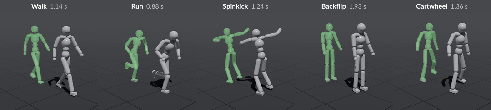

<div align="center">

<h1>InstantMimic</h1>

<p><strong>A High Performance System for Learning Physics-based Skills in Seconds</strong></p>

<p><a href="https://scripter36.github.io/">Ikjun Choi</a> ·
<a href="https://daebangstn.github.io/">Geonho Leem</a> ·
<a href="https://sites.google.com/view/jungdam">Jungdam Won</a><br>
<a href="https://imo.snu.ac.kr/">Intelligent Motion Lab</a>, Seoul National University</p>

<p>SIGGRAPH Asia 2026</p>

[](https://scripter36.github.io/projects/instantmimic/)
[](https://arxiv.org/abs/2609.09821)
[](https://github.com/Scripter36/InstantMimic/actions/workflows/checks.yml)
[](LICENSE)

</div>

[](https://scripter36.github.io/projects/instantmimic/#motion-demo)

InstantMimic trains physics-based character controllers with reinforcement
learning, fast enough that a humanoid learns to walk, run or backflip in about
one to two seconds of training on a single GPU. Simulation
([MuJoCo Warp](https://github.com/google-deepmind/mujoco_warp)), rollout
collection and PPO updates all stay on the GPU and run as CUDA graphs. The
[motion demonstrations](docs/reference/motion-demo.md) page lists the configs
and timings behind the clips above.

> [!NOTE]
> Coming from the MUSUBI paper? See
> [Muscle simulation and control](docs/guides/muscle-control.md).

## What's included

| Task | Example config | Guide |
| --- | --- | --- |
| Motion imitation with a PD humanoid: walk, run, spinkick, backflip and cartwheel | `humanoid/imitation/walk_pd` | [First run](docs/getting-started/first-run.md) |
| Muscle-actuated characters: SNU humanoid, FreeMusco ostrich and Chimanoid | `snu_humanoid/imitation/walk_musubi` | [Muscle control](docs/guides/muscle-control.md) |
| Latent policies trained on AMASS, and point-goal navigation on top of them | `humanoid/amass/imitation/phc_train_pd_vae` | [AMASS](docs/data/amass-retargeting.md) |
| Unitree G1 motion tracking following BeyondMimic | `unitree_g1/beyondmimic/side_kick` | [BeyondMimic](docs/guides/beyondmimic.md) |
| Hyperparameter searches planned by an LLM agent | `config/hpo/` | [HPO](docs/guides/hpo.md) |

## Getting started

InstantMimic needs an NVIDIA GPU whose driver supports CUDA 12.8, and
[uv](https://docs.astral.sh/uv/getting-started/installation/), which also
installs Python 3.12 if it is missing.

If you use a coding agent, the quickest start is the
[InstantMimic skill](docs/guides/assistant-workflows.md#start-without-a-checkout):
add it to your agent and tell it what to train. The agent sets up the
repository and runs the training for you.

To set it up yourself:

```bash
git clone https://github.com/Scripter36/InstantMimic.git
cd InstantMimic
uv sync --locked
```

Train the humanoid walk, then watch its best checkpoint in the viewer:

```bash
uv run train --config-name humanoid/imitation/walk_pd
uv run play --config-name humanoid/imitation/walk_pd \
  +play.checkpoint='logs/ppo/humanoid/imitation/walk_pd/YOUR_RUN/checkpoints/best_agent.pt'
```

On a machine without a display, [record a video](docs/guides/rendering.md)
instead. The first run compiles its kernels before training starts, and later runs
reuse them. Any setting can be overridden on the command line, for example
`trainer.max_iterations=300`. The
[configuration reference](docs/reference/configuration/index.md) describes them.

When you work in the checkout with Codex or Claude Code, the
`instantmimic-workflows` plugin adds skills for training, evaluation, profiling
and porting environments from other frameworks. See
[assistant workflows](docs/guides/assistant-workflows.md) to install it.

## Documentation

The [documentation](docs/index.md) covers installation, experiment logging,
training and playback, video rendering, the configuration reference and the
simulation runtime. To browse it locally:

```bash
uv run --group docs mkdocs serve
```

## Citation

If you use InstantMimic in your research, please cite:

```bibtex
@inproceedings{choi2026instantmimic,
  title     = {{InstantMimic}: A High Performance System for Learning Physics-based Skills in Seconds},
  author    = {Choi, Ikjun and Leem, Geonho and Won, Jungdam},
  booktitle = {SIGGRAPH Asia 2026 Conference Papers},
  year      = {2026},
  doi       = {10.1145/3829340.3842170}
}
```

## License

Code is licensed under [Apache-2.0](LICENSE). Models and motions keep their own
terms, listed in the [data inventory](data/README.md) and
[third-party notices](THIRD_PARTY_NOTICES.md).

## Acknowledgments

InstantMimic builds on [MuJoCo Warp](https://github.com/google-deepmind/mujoco_warp)
and adapts parts of the [Isaac Lab](https://github.com/isaac-sim/IsaacLab)
direct-workflow environment. The humanoid clips come from
[MimicKit](https://github.com/xbpeng/MimicKit), the ostrich and Chimanoid models
from [FreeMusco](https://github.com/palkan21/FreeMusco), and the G1 tracking task
follows [BeyondMimic](https://github.com/HybridRobotics/whole_body_tracking) and
its [mjlab](https://github.com/mujocolab/mjlab) implementation.
